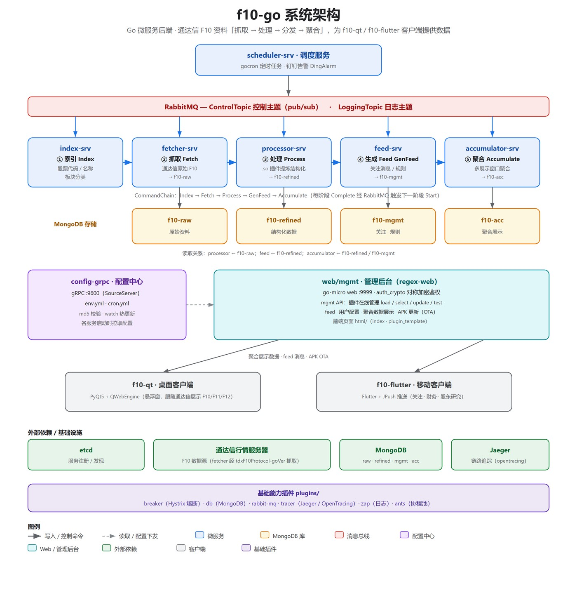

# f10-go

f10-qt 与 f10-flutter 客户端的完整后端系统：基于 Go 微服务架构，完成 A 股通达信 F10 公司资料的抓取、处理、分发与聚合。



## 功能特性

- **微服务架构**：基于 go-micro/v2 + gRPC + etcd 服务注册，各服务独立构建、独立部署。
- **数据流水线**：`Index → Fetch → Process → GenFeed → Accumulate` 五阶段流水线，通过 RabbitMQ 控制主题（`ControlTopic`）以发布/订阅方式串联。
- **原始数据抓取（fetcher-srv）**：通过 `tdxF10Protocol-goVer` 连接通达信行情服务器，抓取股票 F10 原始资料，写入 `f10-raw` 库。
- **数据处理（processor-srv）**：通过可动态加载的 Go 插件（`.so`）把原始数据提炼为结构化字段，内置财务分析、最新提示、经营分析、股东研究等插件，结果写入 `f10-refined` 库。
- **Feed 生成与关注管理（feed-srv）**：按用户规则生成关注消息（focus），支持规则的增删改查、清理过期关注与 CSV 差异导出。
- **数据聚合（accumulator-srv）**：按时间窗口聚合数据，生成多个可展示窗口（`f10`、`f10a_supplement`、`f12_finance`、`f11_industry`、`f10b_shareholder`），写入 `f10-acc` 库。
- **定时调度（scheduler-srv）**：基于 gocron 的 cron 任务调度（`GetCodeName`、`DeleteOutdatedFocus`）与钉钉告警（`DingAlarm`）。
- **配置中心（config-grpc）**：基于 gRPC 的配置服务，向各服务下发 `env.yml` 与 `cron.yml`。
- **管理后台（web/mgmt）**：提供 HTTP API，包括聚合数据展示、处理器插件在线管理、feed 消息与用户配置、APK 更新（OTA）。
- **基础能力**：MongoDB 连接、RabbitMQ 收发、zap 日志、Jaeger 链路追踪、Hystrix 熔断。

## 技术栈 / 依赖

- **语言**：Go 1.13
- **微服务框架**：go-micro/v2 v2.9.1、micro/cli/v2
- **RPC**：gRPC、protobuf
- **服务注册**：etcd
- **数据库**：MongoDB（go.mongodb.org/mongo-driver）
- **消息队列**：RabbitMQ（streadway/amqp）
- **定时任务**：jasonlvhit/gocron
- **日志**：go.uber.org/zap、gopkg.in/natefinch/lumberjack.v2
- **链路追踪**：uber/jaeger-client-go、opentracing-go
- **熔断**：afex/hystrix-go
- **协程池**：panjf2000/ants
- **协议客户端**：sidazhang123/tdxF10Protocol-goVer（通达信 F10 协议）
- **部署**：Docker（alpine 基础镜像）

## 目录结构

```
f10-go
├── basic/                 # 公共库：配置加载、常量定义、插件注册
│   ├── common/            # AppCfg、常量（流水线命令、F10 栏目映射等）
│   └── config/            # 配置中心客户端封装
├── config-grpc/           # gRPC 配置中心（端口 9600）
│   ├── conf/              # env.yml、cron.yml
│   └── main.go
├── plugins/               # 基础能力插件
│   ├── breaker/           # Hystrix 熔断
│   ├── db/                # MongoDB 连接
│   ├── rabbit-mq/         # RabbitMQ 收发
│   ├── tracer/            # Jaeger / OpenTracing 链路追踪
│   └── zap/               # zap 日志
├── srv/                   # 后端微服务
│   ├── scheduler/         # 调度服务（cron 任务 + 钉钉告警）
│   ├── index/             # 索引服务（股票代码/名称列表）
│   ├── fetcher/           # 抓取服务（拉取原始 F10 数据）
│   ├── processor/         # 处理服务（插件提炼结构化数据）
│   │   └── plugins/       # src（插件源码）/ so（编译产物）/ debug
│   ├── feed/              # Feed 服务（关注消息与规则）
│   └── accumulator/       # 聚合服务（时间窗口聚合）
└── web/
    └── mgmt/              # 管理后台 Web 服务（端口 9999）
        ├── handler/       # HTTP 路由处理器
        ├── auth_crypto/   # 对称加密鉴权
        └── html/          # 前端页面
```

## 安装与环境要求

- Go 1.13 及以上。
- 运行时依赖：MongoDB、RabbitMQ、etcd，以及 `config-grpc` 配置中心。

## 使用方法

### 1. 启动配置中心

```bash
cd config-grpc
GOOS=linux GOARCH=amd64 CGO_ENABLED=0 go build -o config-grpc main.go
./config-grpc
```

### 2. 构建并启动服务

各服务目录均提供 Makefile，`make build` 会交叉编译出 Linux amd64 二进制，`make docker` 构建 Docker 镜像。以 feed 服务为例：

```bash
cd srv/feed
make build
./feed-srv
```

其余服务的二进制名（见各自 `Makefile`）：`scheduler-srv`、`index-srv`、`fetcher-srv`、`processor-srv`、`accumulator-srv`、`mgmt-web`。

> 注意：`processor` 服务依赖 C 插件机制，Makefile 使用 `CGO_ENABLED=1` 编译。

也可以直接运行测试：

```bash
cd srv/feed
make test
```

## 配置说明

配置统一由 `config-grpc` 下发，源码中的 `env.yml` 与 `cron.yml` 位于 `config-grpc/conf/`。

- 服务启动时通过 `CONFIG_GRPC_ADDR` 环境变量（部分服务默认 `127.0.0.1:9600`）连接配置中心，读取对应 app 段（如 `feed_srv`、`fetcher_srv`）的配置。
- `env.yml` 主要配置项：
  - `etcd`：服务注册中心地址（`host`/`port`）。
  - `db.mongodb`：MongoDB 连接（`host`/`port`/`username`/`password`/`auth_db`）。
  - `rabbitmq`：消息队列连接与交换器/队列声明参数。
  - 各服务 `params`：如 `fetcher_srv` 的 `worker`、`db_name`，`processor_srv` 的插件路径与数据库名，`feed_srv` 的 `skip_days`、集合名等。
- `cron.yml` 定义定时任务（`GetCodeName`、`DeleteOutdatedFocus`），支持 `every`、`unit`、`at`、`safe` 字段与 `time_zone` 时区设置。

## 输出 / 结果说明

- 数据按处理阶段写入不同 MongoDB 数据库：`f10-raw`（原始）、`f10-refined`（提炼后）、`f10-mgmt`（feed/规则/关注）、`f10-acc`（聚合）。
- 各服务运行日志写入本地 `logs/` 目录（错误与信息分开文件）。

## 注意事项 / 已知限制

- 仓库中提交了若干编译产物与运行日志（如 `srv/fetcher/fetcher-srv`、`srv/processor/processor-srv`、`web/mgmt/regex-web`、`srv/processor/plugins/so/*.so`、`logs/*.log`），体积较大，构建时应以源码为准。
- `go.mod` 声明 Go 1.13，依赖版本较旧，使用较新的 Go 工具链编译时可能需要处理依赖兼容性问题。
- 各服务启动前需确保 MongoDB、RabbitMQ、etcd 与 `config-grpc` 已就绪。
